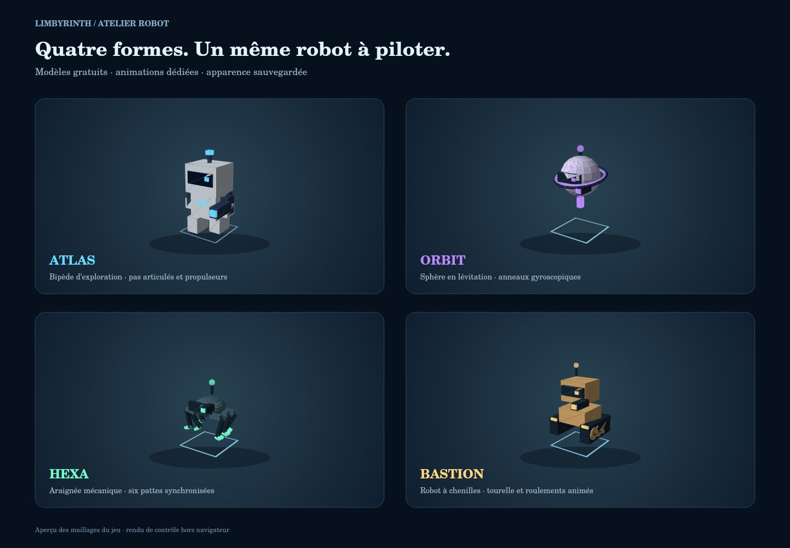

# Limbyrinth — Cube Escape

Jeu 3D de labyrinthe en HTML et Three.js r128, avec quatre niveaux, coopération locale et salons en ligne, commandes tactiles, progression et boutique.

**[▶ Jouer sur GitHub Pages](https://babaw201.github.io/cube-escape/)**

Choisir **« Niveau 1 : Labyrinthe »** pour commencer. Sur téléphone, ouvrir le lien dans Chrome ou Safari.

## Nouveautés

- **Le Labyrinthe instable** : un quatrième niveau à carte fixe, trois phases cyan/magenta/ambre, console centrale, trois clés et portes définitivement ouvertes après stabilisation.
- **Le Traqueur** : ennemi étourdissable par trois tirs, suivi d’une fuite finale de 35 secondes après collecte des trois clés.
- **Quatre formes de robot gratuites** : Atlas bipède, Orbit flottant, Hexa à six pattes et Bastion à chenilles, avec aperçu 3D, animations et sauvegarde. Sélection dans **Boutique → Robots**.
- Éclairage et couleurs ajustés, murs entiers en vue aérienne, HUD de phase et mini-carte complète au niveau 4.
- Nouvelle fin de campagne après le quatrième niveau ; accès conservé pour les anciennes sauvegardes ayant terminé Le Noyau.



## Scores et historique

Depuis l'accueil, appuyer sur **🏆 Scores** pour consulter le tableau des résultats. Il est également accessible depuis l'écran de fin de partie.

- Historique de toutes les parties **enregistrées à partir de cette version** : date, niveau, score, victoire/défaite, mode (solo, coop locale, en ligne), durée, cristaux, drones.
- Meilleur score et nombre de parties/victoires par niveau, points cumulés et record global.
- Filtres par niveau et mode ; tri chronologique ou par score ; export au format CSV.
- Les données sont conservées localement dans le navigateur (`limbyrinthScoresV1`). Le record de l'ancien système (`cubeEscapeBest`) reste visible, sans créer d'historique fictif.
- Les scores ne sont **pas** synchronisés entre appareils et ne forment **pas** un classement mondial. Vider les données du navigateur supprimera l'historique local (sauf sauvegarde CSV préalable).

## Commandes

| Action | Joueur 1 | Joueur 2 local |
| --- | --- | --- |
| Déplacement | ZQSD / WASD | Flèches |
| Tir | Clic gauche | Entrée |
| Dash | Maj gauche | Maj droite |
| Console du niveau 4 | E | O |

**V** : vue subjective (solo ou en ligne). **P** : pause solo/local. **M** : son. Sur mobile : joystick et boutons TIR, DASH, VUE et PHASE près de la console.

## Jouer hors connexion

Télécharger le dépôt et ouvrir `index.html` en conservant le dossier `vendor`, ou télécharger le fichier autonome [`Limbyrinth.html`](Limbyrinth.html) et l’ouvrir dans un navigateur compatible WebGL. Three.js est fourni localement avec sa licence.

## Pseudos et amis (version expérimentale)

Dans le menu **👥 Amis & pseudo**, créer un profil avec un pseudo unique (3–16 caractères : lettres non accentuées, chiffres, soulignement ; commence par une lettre). Ensuite, on peut envoyer une demande à un pseudo exact, accepter/refuser, retirer ou bloquer un joueur, et inviter un ami confirmé dans un salon coopératif.

- Les profils et amitiés sont gérés par le service Cloudflare `/social/*` du Worker `limbyrinth-online`, avec stockage SQLite Durable Object.
- **Déploiement du Worker nécessaire** : il faut déployer `online/wrangler.jsonc` (migration `v2` ajoutant `SocialHub`) et `online/social.mjs` avant d'activer l'interface sur le site. Test conseillé avec deux navigateurs distincts.
- L'identifiant d'accès privé reste dans le stockage du navigateur, jamais dans un lien partagé ; il n'existe **pas de récupération de compte ou de synchronisation entre appareils** dans cette première version. Ne pas effacer les données du navigateur si l'on veut conserver ce profil.
- Les demandes nécessitent l'acceptation explicite du destinataire ; pas d'annuaire public, pas de messagerie privée ; bloquer retire les liens existants.
- Les invitations à rejoindre un salon expirent automatiquement après 15 minutes. La liste est rafraîchie lorsque le joueur ouvre **Amis & pseudo** ou clique sur *Actualiser*.
- Ce n'est pas un système complet de comptes (absence d'e-mail, de mot de passe, de restauration et de modération avancée). Pour une diffusion publique importante, ajouter des protections renforcées et un mécanisme de récupération.

## Jouer avec un ami

1. L’hôte ouvre **Jouer en ligne → Créer un salon**.
2. Il partage le **code court** ou le **lien d’invitation**. Son ami ouvre le lien, ou saisit le code dans **Rejoindre le salon**.
3. Une fois les deux joueurs connectés, l’hôte choisit le niveau.

Les salons accueillent deux joueurs. Le code expire après 15 minutes d’attente ; une session connectée dure au maximum deux heures. **Quitter le salon** permet de revenir au jeu local. Un message explique les codes invalides, salons complets ou expirés et déconnexions.

La connexion passe par un relais WebSocket ; aucun long code WebRTC à échanger. Les transitions, portes et ramassages restent validés par l’hôte. Le service et sa configuration sont dans [`online/`](online/README.md).

## Vérification

Avec Node 24 :

```sh
npm install
npm test
npm run preview:robots
```

**41 tests passent** (jeu, client et service de salons) : carte/BFS et accès aux ailes, 100 transitions avec occupants, portes fermées solides à l’approche, console/cooldown, clés et alarme, étourdissement, snapshots et autorité hôte, modèles en coopération, anciennes sauvegardes et régressions des niveaux 1–3. Le parcours complet sans ennemi utilise les mouvements et collisions réels. Les tests de salons vérifient aussi les rôles, la capacité à deux joueurs, la déconnexion, l’expiration, les annulations et les raccourcis clavier pendant la saisie.

Le démarrage d’un niveau a aussi été vérifié sur la version hébergée dans un navigateur, avec une fenêtre bureau et une fenêtre mobile de 390×844 : clic sur le niveau, fermeture du menu, animation et absence d’erreurs JavaScript lors de ces contrôles. Le nouveau service a été vérifié avec deux connexions WebSocket réelles. L’écran de connexion a été testé au format mobile : saisie sans déclenchement des raccourcis, arrivée d’un invité, départ au niveau 4, synchronisation de phase, commandes et sortie du salon. La fluidité sur téléphone physique et le parcours complet avec le Traqueur restent à vérifier.

Pour lancer la suite navigateur complète :

```sh
npx playwright install chromium
npm run test:browser
```

`CHROMIUM_PATH` permet de sélectionner un Chromium installé. Les tests Node utilisent la logique et les géométries Three.js réelles, avec un DOM de test et la frontière WebGL remplacée. L’image des robots est un rendu de contrôle des maillages.

Le cahier des charges du niveau 4 est dans [`docs/level4-spec.md`](docs/level4-spec.md). L’ancienne variante HTML du dépôt est conservée.
